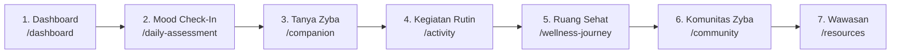

# ZYBA Master Design System

> Generated with UI/UX Pro Max Architectural Engine.  
> **COLOR LOCK NOTICE**: Seluruh rekomendasi warna bawaan generator dibuang sesuai Aturan Mutlak. Skema warna 100% menggunakan Canonical Tokens dari `PALETTE_LOCK.md`.

---

## 1. Style & Philosophy: Warm Organic Clarity (Soft UI Evolution)

ZYBA didesain khusus untuk individu yang membutuhkan kenyamanan emosional dan ketenangan pikiran.
- **Pendekatan Visual**: Soft UI Evolution — kedalaman visual yang halus, kontras terukur (memenuhi WCAG AA ≥ 4.5:1), bayangan lembut bertingkat (*ambient diffusion*), tanpa efek glassmorphism berat yang membebani GPU perangkat.
- **Nada Emosional**: Tenang (*calm*), hangat (*warm*), aman (*safe*), dan memberdayakan (*supportive*).
- **Anti-Pattern Terlarang**: Dilarang menggunakan animasi berkedip (*flash/ping* agresif), elemen gamifikasi yang memicu kecemasan (angka streak bernada menghukum, penghitung mundur stres), copy sensasional/hype, kartu bertumpuk tanpa fungsi (*card inception*), dan emoji sebagai pengganti ikon fungsional.

---

## 2. Locked Brand Color Tokens (PALETTE_LOCK.md)

| Peran Semantik | Token Nama | Canonical Hex | Kelas Tailwind | Penggunaan |
|---|---|---|---|---|
| Canvas / App Background | Cream | `#F7F2E7` | `bg-cream` | Background seluruh aplikasi & viewport |
| Surface Default | White Soft | `#FFFFFF` | `bg-white` / `bg-white/90` | Kartu utama, panel konten, modal |
| Surface Accent Calm | Green 100 | `#E4EED2` | `bg-green-100` | Kartu rutinitas sehat, active nav item |
| Surface Accent Warm | Orange 100 | `#FCE3D3` | `bg-orange-100` | Kartu catatan hangat, badge pill |
| Primary Text & Headings | Brown 900 | `#3B2A20` | `text-brown-900` | H1-H4, judul kartu, label form tebal |
| Secondary & Muted Text | Brown 700 | `#5A4636` | `text-brown-700` | Deskripsi, body copy, timestamp, caption |
| Primary CTA / Vital Accent | Orange 500 | `#F2884B` | `bg-orange-500` | Tombol aksi utama, submit, highlight |
| Secondary CTA / Positive | Green 500 | `#8FAE5D` | `bg-green-500` | Tombol aksi sekunder, indikator progres baik |
| Border Default | Border Subtle | `rgba(59, 42, 32, 0.10)` | `border-brown-900/10` | Pemisah antar kartu dan container |
| Focus Ring | Focus Warm | `rgba(242, 136, 75, 0.40)` | `ring-orange-500/40` | Status keyboard focus terstandarisasi |
| Destructive Action | Danger | `#D9534F` | `bg-danger` | Tombol hapus akun/post saja |

### Mood Emotional Tokens (Terkunci)
- **Depressed**: `#A99BE0` (`bg-mood-depressed`) — Lavender teduh
- **Sad**: `#EE8A5E` (`bg-mood-sad`) — Terracotta lembut
- **Neutral**: `#6B5645` (`bg-mood-neutral`) — Earthy brown
- **Happy**: `#E8C24A` (`bg-mood-happy`) — Warm golden
- **Overjoyed**: `#8FAE5D` (`bg-mood-overjoyed`) — Olive sage

---

## 3. Tipografi Resmi

Berdasarkan `AGENTS.md` (Bagian 3.2):
- **Display & Headings**: `Manrope` (`font-display`, weights: 600, 700, 800)
  - Display Besar: `text-3xl sm:text-4xl font-bold tracking-tight text-brown-900`
  - H1 Halaman: `text-2xl sm:text-3xl font-bold text-brown-900 tracking-tight`
  - H2 Kartu / Section: `text-lg sm:text-xl font-semibold text-brown-900`
  - H3 Subtitle: `text-sm sm:text-base font-semibold text-brown-900`
- **Body & Interface**: `DM Sans` (`font-body`, weights: 400, 500, 700)
  - Body Text: `text-sm sm:text-base text-brown-700 leading-relaxed`
  - Caption / Metadata: `text-xs text-brown-700/80 font-medium`
  - Tombol / Label: `text-xs sm:text-sm font-semibold tracking-wide`

---

## 4. Spacing Scale & Radius System

- **Spacing Scale**:
  - `space-1` (4px), `space-2` (8px), `space-3` (12px), `space-4` (16px), `space-6` (24px), `space-8` (32px), `space-12` (48px)
  - Padding kartu standar: `p-5 sm:p-6 lg:p-7`
  - Jarak antar seksi vertikal: `space-y-6 sm:space-y-8`
- **Radius System**:
  - `rounded-pill` (`rounded-full` / 999px) — Tombol aksi (primer/sekunder), tag filter, badge status
  - `rounded-3xl` (24px) — Kartu fitur utama, container besar, modal
  - `rounded-2xl` (16px) — Kartu ringkasan kecil, widget item, input text
  - `rounded-xl` (12px) — Dropdown menu, badge status kecil

---

## 5. Struktur Navigasi & Alur Pengguna Terstandarisasi

Struktur navigasi sidebar kiri desktop (`Sidebar.tsx`) dan bottom navigation (`MobileBottomNav.tsx`) disusun dalam alur alami perjalanan pengguna:

### Label & Rute Navigasi Bersih:
1. **Dashboard** (`/dashboard`) — Ringkasan kondisi diri & rencana hari ini
2. **Mood Check-In** (`/daily-assessment`) — Evaluasi perasaan harian & catatan reflektif
3. **Tanya Zyba** (`/companion`) — Teman curhat AI yang empatik & aman
4. **Kegiatan Rutin** (`/activity`) — Smart Activity Planner & latihan relaksasi
5. **Ruang Sehat** (`/wellness-journey`) — Tren kesejahteraan & riwayat jurnal
6. **Komunitas Zyba** (`/community`) — Ruang berbagi yang aman & saling mendukung
7. **Wawasan** (`/resources`) — Artikel terkurasi & panduan kesehatan mental

Menu Sekunder / Dukungan:
- **Pencapaian** (`/achievements`)
- **Buku Panduan** (`/guidebook`)
- **Analisis Mendalam** (`/settings/zyba-plus/insights`) — Khusus Zyba+

---

## 6. Aturan Komponen & Interaksi (UX Rules)

### A. Tombol (Buttons)
- **Primary Button**: `bg-brown-900 text-cream hover:bg-brown-900/90 active:scale-[0.99] rounded-pill px-5 py-2.5 font-medium transition-all`
- **Warm Accent CTA**: `bg-orange-500 text-white hover:bg-orange-500/90 active:scale-[0.99] rounded-pill px-5 py-2.5 font-semibold shadow-sm transition-all`
- **Secondary / Soft Button**: `bg-green-100 text-brown-900 hover:bg-green-100/80 rounded-pill px-4 py-2 font-medium transition-colors`
- **Outline Button**: `border border-brown-900/15 text-brown-900 hover:bg-white/80 rounded-pill px-4 py-2 font-medium transition-colors`

### B. Form & Input Fields
- `h-11 px-4 rounded-2xl bg-white/90 border border-brown-900/15 text-brown-900 placeholder:text-brown-700/50 focus:outline-none focus:ring-2 focus:ring-orange-500/30 focus:border-orange-500/70 transition-all text-sm`
- Selalu sediakan label yang jelas dan deskriptif.

### C. State Interaksi & Aksesibilitas
- **Keyboard Navigation**: Setiap elemen interaktif (`a`, `button`, `input`) wajib memiliki `focus-visible:outline-none focus-visible:ring-2 focus-visible:ring-orange-500/40 focus-visible:ring-offset-2`.
- **Target Sentuh**: Minimal `min-h-[44px]` dan `min-w-[44px]` pada mobile.
- **Transisi Halus**: `150ms` hingga `200ms ease-out`. Hindari durasi lama (>400ms) yang terasa lamban.
- **Prefers Reduced Motion**: Otomatis menonaktifkan transform dan parallax saat `prefers-reduced-motion: reduce` aktif di perangkat pengguna.

### D. Empty States & Error States
- **Empty State**: Tampilkan ilustrasi SVG garis tenang, judul ramah, dan 1 tombol aksi utama (mis. "Mulai Check-In Hari Ini"). Jangan biarkan kontainer kosong polos tanpa konteks.
- **Error State**: Teks error menggunakan warna lembut dengan penjelasan solutif (bukan merah menyala yang mengagetkan).
- **Crisis Gate**: Komponen `CrisisBanner` dan `CrisisModal` selalu berada pada posisi prioritas pandang tertinggi dengan tombol kontak hotline darurat yang kontras dan mudah diketuk (telepon/tautan langsung).

