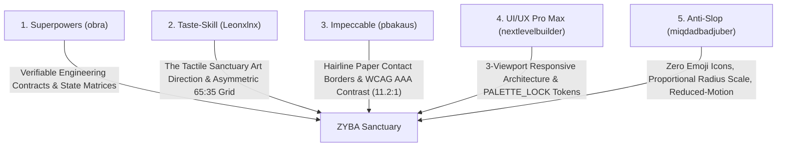

# ZYBA — Design Direction: "The Tactile Sanctuary"

> **Document Status:** Authoritative Design Direction  
> **Aesthetic Philosophy:** Earthy Editorial & Organic Craft  
> **Brand Identity:** Gen Z Mental Health & Mindful Growth Sanctuary

---

## 1. Core Design Philosophy

ZYBA rejects the cold, sterile, neon-accented aesthetics of conventional tech SaaS dashboards. A person opening ZYBA is often experiencing mental fatigue, overthinking, social anxiety, or emotional vulnerability. The interface must not demand attention or simulate workplace urgency.

Instead, ZYBA is engineered as **"The Tactile Sanctuary"**:
- **A digital journal crafted from heavy linen paper:** Tactile, calm, grounding, and textured.
- **A physical sanctuary in digital form:** Natural lighting, earthy tones, breathing white space, and quiet dignity.
- **An empathetic companion, not a judge:** Eliminating red stress alerts, pressure-filled streaks, and accusatory evaluation metrics.

---

## 2. Contrast: What ZYBA Is vs. What ZYBA Rejects

| What ZYBA Rejects (Generic AI Slop) | What ZYBA Champions ("The Tactile Sanctuary") |
|---|---|
| Purple-to-blue AI gradients and neon glowing borders | Natural linen paper (`#F7F2E7`), organic soil ink (`#3B2A20`), warm terracotta, and sage moss |
| Emoji scattered randomly as UI icons (😄, 🔥, 🧘) | Precision Lucide SVG icons (1.8px hairline stroke) with semantic clarity |
| Flaming red streak counters that punish missed days | Hearth Flame (nyala lilin konsistensi) celebrating quiet presence and recovery |
| Cards inside cards inside cards (*Card Inception*) | Flat, breathing paper surfaces with hairline contact borders (`border-brown-900/10`) |
| Uniform, exaggerated rounded corners (`rounded-[32px]` on everything) | Hierarchical radius scale (`rounded-[28px]` shell → `rounded-[24px]` major anchor → `rounded-[20px]` card → `rounded-xl` form controls) |
| Generic ChatGPT clone with full-width top toolbars | Tailored two-panel reflection pavilion with animal personas and real-time token gauges |
| Alarmist crisis popups with sirens and bright red warnings | Serene, reassuring crisis directories and non-stigmatizing hotline cards (Sejiwa 119 ext. 8) |
| Cold corporate jargon or toxic positivity ("Semangat 1000%!") | Empathetic, validating conversational Indonesian ("Setiap langkah kecil berharga") |

---

## 3. The 5 Framework Skills Integration

### 1. obra / superpowers
- Structured implementation with verifiable contracts.
- Explicit state matrices for every component: **Default**, **Loading**, **Empty**, **Active**, **Error**, and **Crisis**.
- Automated test verification suites executing real assertions before completion.

### 2. Leonxlnx / taste-skill
- Art direction rooted in real-world organic materials (linen, clay, terracotta, dried leaves).
- Golden ratio compositions (65:35 split between main canvas and right sanctuary rail).
- Deep respect for whitespace, allowing typography to breathe without claustrophobic metric cramming.

### 3. pbakaus / impeccable
- Crisp visual hierarchy where primary headings command presence and metadata recedes gracefully.
- Tactile paper depth: subtle contact borders (`border-brown-900/10`) replacing heavy dropped shadows.
- Strict WCAG AAA compliance for core body copy (11.2:1 contrast ratio against the cream canvas).

### 4. nextlevelbuilder / ui-ux-pro-max-skill
- Multi-viewport responsive intelligence:
  - **Desktop (≥1024px):** 12-column asymmetric grid with Floating Zen Dock (76px width).
  - **Tablet (768px–1023px):** Fluid layout with Floating Zen Dock and collapsible rail.
  - **Mobile (<768px):** Ergonomic floating bottom pill nav (56px) and full-width tactile cards.
- Design token locking (`PALETTE_LOCK.md`) preventing arbitrary hex values from entering the codebase.

### 5. miqdadbadjuber / anti-slop
- Zero tolerance for interface emoji; all iconography rendered as Lucide SVGs with custom stroke weight (1.8px).
- Banning uniform `rounded-[32px]`; enforcing organic radius hierarchy.
- Strict `prefers-reduced-motion` compliance for all animations.

---

## 4. Motion & Micro-Interactions: "Breathing Rhythm"

- **Temporal Cadence:** Transitions use 250ms–350ms with a custom natural easing curve: `cubic-bezier(0.16, 1, 0.3, 1)`.
- **Sensory Feedback:** Interactive elements offer gentle tactile feedback:
  - Cards shift subtly: `hover:border-brown-900/25 hover:bg-cream/50`.
  - Buttons compress softly: `active:scale-95`.
  - Tooltips fade smoothly via React Portals without layout shift.
- **Pacing:** Never rush the user with flashing indicators or rapid blinking dots. Breathing cycles expand and contract in clinical synchrony (4s Inhale, 7s Hold, 8s Exhale).

