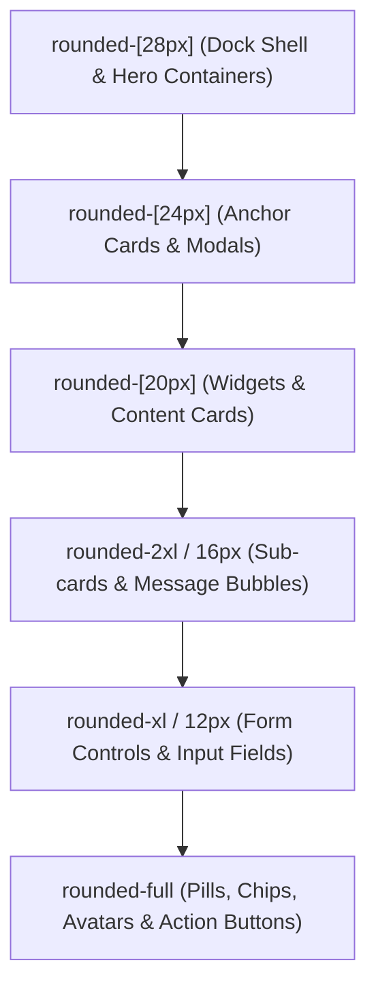

# ZYBA — Complete Design System Specification

> **Document Status:** Authoritative Design System Specification  
> **Source of Truth:** Synchronized with `design-system/PALETTE_LOCK.md` and `design-system/zyba/MASTER.md`

---

## 1. Color Palette Tokens & Accessibility Matrix

| Token Name | Hex Value | Tailwind Class | Contrast Ratio vs `#F7F2E7` | Accessibility Rating | Semantic Purpose |
|---|---|---|:---:|:---:|---|
| **Canvas / Base** | `#F7F2E7` | `bg-cream`, `text-cream` | Base | — | 75% surface canvas; linen paper texture |
| **Ink / Primary Text** | `#3B2A20` | `bg-brown-900`, `text-brown-900` | **11.2:1** | **WCAG AAA** | Primary headings, structural hairline borders, primary buttons |
| **Charcoal / Secondary** | `#5A4636` | `bg-brown-700`, `text-brown-700` | **7.4:1** | **WCAG AAA** | Secondary body text, subheadings, metadata captions |
| **Warmth Accent / CTA** | `#F2884B` | `bg-orange-500`, `text-orange-500` | **3.2:1** | **Large/Bold Text** | Primary action buttons, emotional warmth highlights, active states |
| **Warmth Surface** | `#FCE3D3` | `bg-orange-100`, `text-orange-100` | 1.15:1 | Decorative | Warm card backgrounds, subtle reflection tags, notification pills |
| **Vitality / Growth** | `#8FAE5D` | `bg-green-500`, `text-green-500` | **3.3:1** | **Large/Bold Text** | Recovery indicators, completed checklist items, success states |
| **Vitality Surface** | `#E4EED2` | `bg-green-100`, `text-green-100` | 1.12:1 | Decorative | Physical rest card backgrounds, active nav pill indicators |
| **Mood: Depressed** | `#A99BE0` | `bg-mood-depressed` | 3.1:1 | Decorative | Lavender tint representing grief, heavy burdens, or deep rest |
| **Mood: Sad** | `#EE8A5E` | `bg-mood-sad` | 3.5:1 | Decorative | Terracotta tint representing melancholy, vulnerability, or fatigue |
| **Mood: Neutral** | `#6B5645` | `bg-mood-neutral` | 5.8:1 | **WCAG AA** | Earthy brown representing calm, quiet observation, or stillness |
| **Mood: Happy** | `#E8C24A` | `bg-mood-happy` | 1.6:1 | Decorative | Golden sunlight representing gratitude, joy, and peace |
| **Mood: Overjoyed** | `#8FAE5D` | `bg-mood-overjoyed` | 3.3:1 | Decorative | Vibrant olive representing vitality, enthusiasm, and celebration |
| **Danger / Destructive** | `#D9534F` | `bg-danger`, `text-danger` | **4.6:1** | **WCAG AA** | **Strictly** for account deletion or unrecoverable actions. Never for crisis states. |

---

## 2. Typography Hierarchy

| Style Token | Font Family | Size | Weight | Tracking & Leading | Tailwind Equivalent | Use Case |
|---|---|---|---|---|---|---|
| **Display Hero** | `Manrope` | 36px–48px | 800 (Extrabold) | `-0.025em`, `leading-tight` | `font-display text-3xl sm:text-4xl lg:text-5xl font-extrabold tracking-tight` | Landing headline, welcome sanctuary hero |
| **Section Title (H1)** | `Manrope` | 24px–32px | 700 (Bold) | `-0.02em`, `leading-tight` | `font-display text-2xl sm:text-3xl font-bold tracking-tight` | Major view titles, modal headers |
| **Card Title (H2)** | `Manrope` | 18px–20px | 700 (Bold) | `-0.01em`, `leading-snug` | `font-display text-lg sm:text-xl font-bold` | Anchor card titles, widget headers |
| **Subheading (H3)** | `DM Sans` | 15px–16px | 600 (Semibold) | `0em`, `leading-snug` | `font-body text-sm sm:text-base font-semibold` | Module headers, list item headings |
| **Body Large** | `DM Sans` | 16px | 400 (Normal) | `0.01em`, `leading-relaxed` | `font-body text-base font-normal text-brown-700 leading-relaxed` | Reader mode, companion chat responses |
| **Body Regular** | `DM Sans` | 14px | 400 (Normal) | `0.01em`, `leading-relaxed` | `font-body text-sm font-normal text-brown-700 leading-relaxed` | General card text, form labels, feed items |
| **Caption / Meta** | `DM Sans` | 12px | 500 (Medium) | `0.02em`, `leading-normal` | `font-body text-xs font-medium text-brown-700/80` | Timestamps, author metadata, tags |
| **Micro Badge** | `DM Sans` | 10px–11px | 700 (Bold) | `0.04em`, `uppercase` | `font-body text-[10px] sm:text-[11px] font-bold uppercase tracking-wider` | Pill indicators, status pills, count badges |

---

## 3. Layout, Grid & Spatial System

### A. Layout Dimensions
- **Max Container Width:** `1200px` to `1280px` (`max-w-7xl mx-auto`).
- **Floating Zen Dock (Desktop ≥768px):** Width `76px` (`md:w-[76px] lg:w-[76px]`), fixed floating at `md:left-4`, container padding `md:pl-[108px]`.
- **Ergonomic Bottom Nav (Mobile <768px):** Height `56px`, floating pill centered at bottom with `z-40` backdrop blur.
- **Profile Popover Anchor:** Anchored dynamically at `left: 104px` (`md:left-[104px]`) on desktop, switching to centered bottom sheet on mobile.

### B. Asymmetric 65:35 Golden Grid
```
┌─────────────────────────────────────────────────────────────┬───────────────────────────┐
│ MAIN SANCTUARY CANVAS (68% / 8 Columns on lg)               │ SANCTUARY RIGHT RAIL (32%)│
│ - Deep Sage Container Anchor (Hero Greeting & Persona)      │ - Specialist AI Card      │
│ - 3 Tactile Metric Cards (Streak, Score, Conversations)    │ - Kotak Tenang Trigger    │
│ - Weekly Mindful Tasks Card                                 │ - Today's Routine List    │
│ - Tanya Zyba Companion Gateway                              │ - Mood Check-In Banner    │
│ - Catmull-Rom Cubic Bézier Waveform Chart                   │ - Score Breakdown         │
└─────────────────────────────────────────────────────────────┴───────────────────────────┘
```

---

## 4. Radius Hierarchy (Anti-Slop Radius Scale)



- **Shell Containers & Zen Dock:** `rounded-[28px]`
- **Major Anchor Cards & Dialogs:** `rounded-[24px]`
- **Standard Cards & Interactive Widgets:** `rounded-[20px]`
- **Nested Sub-cards & Chat Message Bubbles:** `rounded-2xl` (16px)
- **Form Controls, List Rows & Textareas:** `rounded-xl` (12px)
- **Action Buttons, Pills, Chips & Avatars:** `rounded-full` (or `rounded-lg` 8px for square tags)

