# ZYBA — 10-Phase Implementation & Execution Plan

> **Document Status:** Authoritative Master Plan  
> **Development Methodology:** Obra / Superpowers (Incremental Verification & Verifiable Milestones)

---

## Roadmap Overview

```mermaid
flowchart LR
    P1["1. Discovery"] --> P2["2. Design Direction"]
    P2 --> P3["3. Foundation"]
    P3 --> P4["4. Public Pages"]
    P4 --> P5["5. Main App"]
    P5 --> P6["6. Remaining Pages"]
    P6 --> P7["7. Interaction & Motion"]
    P7 --> P8["8. Responsive Polish"]
    P8 --> P9["9. QA & Critique"]
    P9 --> P10["10. Documentation"]
```

---

## Detailed Phase Breakdown

### Phase 1 — Discovery & Codebase Audit
- **Objective:** Exhaustive exploration of the real repository without making assumptions.
- **Deliverables:**
  - Audit dependencies, scripts, multi-database Prisma configuration.
  - Discover and catalog all 26 frontend routes and 37 API route handlers.
  - Document findings in `docs/redesign/PROJECT-AUDIT.md` and `docs/redesign/ROUTE-INVENTORY.md`.
- **Exit Criteria:** Zero unidentified routes; build-time requirements and environment variables cataloged.

### Phase 2 — Design Direction & Reference Synthesis
- **Objective:** Establish the unique art direction for ZYBA inspired by the 15 design references.
- **Deliverables:**
  - Deconstruct references (Solma, Solune, Pixelean, Gently, Wellora, Mindro, Aura, MindMate, Heal).
  - Define "The Tactile Sanctuary" aesthetic: earthy editorial linen, organic ink, breathing whitespace.
  - Enforce anti-slop rules: zero emoji icons, proportional radius scale, no card inception.
  - Document in `docs/redesign/REFERENCE-ANALYSIS.md` and `docs/redesign/DESIGN-DIRECTION.md`.
- **Exit Criteria:** Design philosophy locked and agreed upon.

### Phase 3 — Foundation & Design System Infrastructure
- **Objective:** Construct the foundational tokens, typography, layouts, and reusable components.
- **Deliverables:**
  - Semantic color token matrix (`PALETTE_LOCK.md` integration): Cream `#F7F2E7`, Brown `#3B2A20`, Terracotta `#F2884B`, Sage `#8FAE5D`.
  - Typography scale: `Manrope` (`font-display`) and `DM Sans` (`font-body`).
  - Layout shells: Floating Zen Dock (76px width), portal tooltips, and mobile bottom pill nav (56px).
  - Core components: `GroundingModal`, `AmbientSoundDock`, `UserAvatar`, `ProfilePopover`.
  - Document in `docs/redesign/DESIGN-SYSTEM.md` and `docs/redesign/COMPONENT-INVENTORY.md`.
- **Exit Criteria:** Foundations compile cleanly without type or build errors.

### Phase 4 — Public & Onboarding Experience
- **Objective:** Deliver an inviting, reassuring, and conversion-optimized public experience.
- **Deliverables:**
  - Landing page overhaul (`src/app/page.tsx`, `LandingHero.tsx`): 4 perspective 3D cards, 99% satisfaction rate with 5 sanctuary pillar icons, 74.9M+ trust bar.
  - Auth entry points (`/login`, `/onboarding`): Serene, secure, zero plain-text passwords.
  - 8-Step Onboarding Intake (`/assessment`): Avatar, Security PIN, Notification preferences, Goals, Demographics, Mood/Sleep, Stress/Symptoms, AI Expression Screening.
  - Server-side route gating via `middleware.ts`.
- **Exit Criteria:** Unauthenticated users guided seamlessly through onboarding ritual.

### Phase 5 — Main Application Sanctuary
- **Objective:** Elevate core daily wellness experiences into high-craft sanctuary spaces.
- **Deliverables:**
  - **Sanctuary Dashboard (`/dashboard`):** Contextual Jakarta greeting, emotional weather badge, routine checklist synced to DB, score breakdown.
  - **Zyba Companion (`/companion`):** Two-panel pavilion, animal persona switcher, Groq Whisper STT, real-time token quota meter (`TokenMeterBadge`).
  - **Mood Check-In (`/mood-check-in`):** 5 canonical mood pebbles, sleep rating slider, reflective journal box, crisis safety triggers.
  - **Smart Activity Planner (`/activity`):** 4-7-8 breathing garden with clinical pacing (4s Inhale, 7s Hold, 8s Exhale), routine habit checklist, 100% Lucide SVG icons.
  - **Ruang Sehat (`/wellness-journey`):** Catmull-Rom cubic Bézier smooth spline chart, Progress Overview Banner, Ring Skor Hening SVG 84px.
  - **Lingkar Komunitas Hangat (`/community`):** Support circle feeds, "Kirim Pelukan" (*Hug*) interaction, empathetic topic tags, Sejiwa 119 ext. 8 hotline card.
- **Exit Criteria:** All 5 core pillars fully functional, responsive, and tactile.

### Phase 6 — Remaining Pages & Specialty Workflows
- **Objective:** Redesign all auxiliary, library, milestone, and administrative surfaces.
- **Deliverables:**
  - Curated Sanctuary Library (`/resources`, `/resources/[slug]`): Reader mode, audio narration bar, PRO gating.
  - Quiet Milestones (`/achievements`): Hearth consistency badges, milestone unlocks.
  - Crisis Directory (`/guidebook`): Emergency telephone numbers, clinical grounding reference.
  - Account Settings & Billing (`/settings`, `/settings/billing`, `/settings/zyba-plus`): GDPR data export, account deletion across all 3 databases, manual payment processing.
  - Admin Operations (`/admin/moderation`, `/admin/payments`): Flagged content queue, appeal reviews, payment receipt approvals.
- **Exit Criteria:** 100% of discovered routes in `ROUTE-INVENTORY.md` updated and styled.

### Phase 7 — Interaction, Motion & Tactile Feedback
- **Objective:** Bring the application to life with purposeful, calm micro-interactions.
- **Deliverables:**
  - Natural easing cadence (250ms–350ms `cubic-bezier(0.16, 1, 0.3, 1)`).
  - Kotak Tenang Grounding 5-4-3-2-1 sensory flow with DB persistence and reactive fresh data notification.
  - Persistent Ambient Soundscape Dock playing uninterrupted across client-side page transitions.
  - Real-time token consumption badge reflecting live AI conversation usage.
  - Full compliance with `prefers-reduced-motion`.
- **Exit Criteria:** Every interactive button, link, toggle, and dropdown has a working action.

### Phase 8 — Responsive Refinement & Cross-Viewport Polish
- **Objective:** Ensure flawless ergonomics across all device form factors.
- **Deliverables:**
  - Viewports: Mobile 360x800 & 390x844, Tablet 768x1024 & 1024x768, Desktop 1280x800 & 1440x900.
  - Touch target compliance ($\ge 44\text{px} \times 44\text{px}$).
  - Eradicate horizontal scroll overflow and modal clipping.
  - Seamless transition from Desktop Zen Dock (76px) to Mobile Bottom Pill Nav (56px).
- **Exit Criteria:** 0 visual clipping; 0 horizontal overflows across all tested resolutions.

### Phase 9 — Quality Assurance, Security Audit & Design Critique
- **Objective:** Rigorous automated and visual verification of the entire product.
- **Deliverables:**
  - TypeScript strict check (`npx tsc --noEmit`): 0 errors.
  - Next.js production build (`npm run build`): All 76 pages succeed.
  - 4 Automated Verification Suites (E2E Phase 1-5, Security Round 2, Security Round 3, Registration flow): 100% PASS (129/129 assertions).
  - Impeccable & Anti-Slop design critique audit.
  - Document in `docs/redesign/QA-CHECKLIST.md`.
- **Exit Criteria:** All tests pass with zero regressions or security vulnerabilities.

### Phase 10 — Documentation Synchronization & Delivery
- **Objective:** Maintain a single source of truth across all architectural documents.
- **Deliverables:**
  - Synchronize `AGENTS.md`, `design.md`, `PALETTE_LOCK.md`, and mockdocs in `design-system/zyba/pages/`.
  - Compile the Final Delivery Report detailing all changes, metrics, and outcomes.
- **Exit Criteria:** All documentation up to date and verified.

